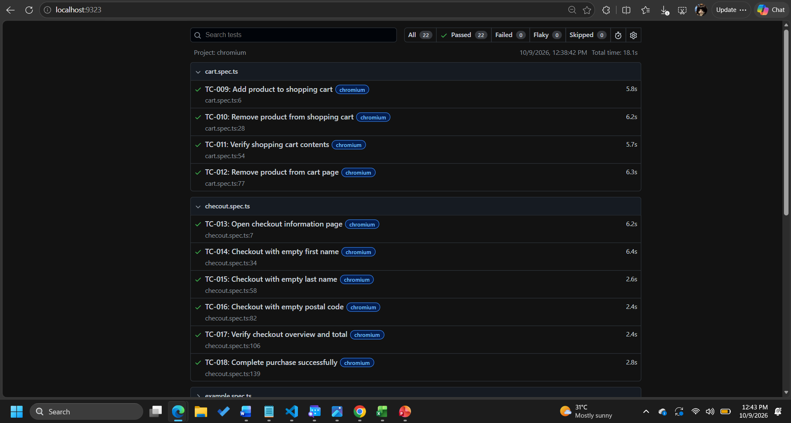
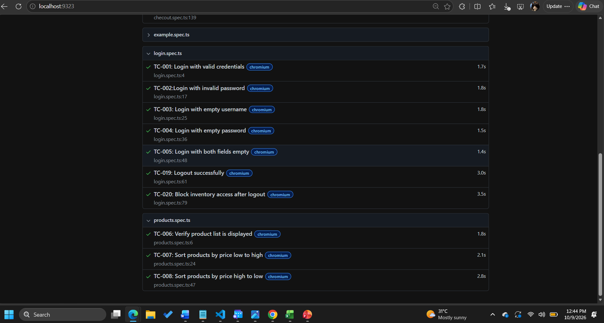

# E-Commerce Website — QA Testing & Automation Project

A self-driven Quality Assurance (QA) portfolio project demonstrating manual testing, UI automation, API testing, test documentation, Agile workflow practice, and version control using public demo applications.

## Table of Contents

- [Project Overview](#project-overview)
- [Technologies Used](#technologies-used)
- [Project Structure](#project-structure)
- [Screenshots](#screenshots)
- [Prerequisites](#prerequisites)
- [Installation and Setup](#installation-and-setup)
- [Running Automated Tests](#running-automated-tests)
- [Automated Test Coverage](#automated-test-coverage)
- [API Testing](#api-testing)
- [Manual Testing Documentation](#manual-testing-documentation)
- [Jira — Agile Workflow Practice](#jira--agile-workflow-practice)
- [Test Reports](#test-reports)
- [Project Scope and Limitations](#project-scope-and-limitations)
- [Learning Objectives](#learning-objectives)

## Project Overview

The purpose of this project is to practise and demonstrate essential QA skills used in software development.

The project covers:

- Manual test planning, test scenarios, and test case execution
- Positive, negative, and exploratory testing
- Browser-based UI automation using Playwright and TypeScript
- REST API request and response validation using Postman
- Automated test reporting and evidence collection
- Jira backlog management, user stories, tasks, and sprint workflow practice
- Version control and project documentation using Git and GitHub

Two separate public learning applications are used:

- **UI testing:** [SauceDemo](https://www.saucedemo.com/)
- **API testing:** [JSONPlaceholder](https://jsonplaceholder.typicode.com/)

The UI tests cover login validation, product listing and sorting, shopping cart operations, checkout, order completion, logout, and protected-page access.

**Important:** JSONPlaceholder is used independently for API practice. These API exercises do not test SauceDemo's internal backend.

## Technologies Used

| Technology | Purpose |
|---|---|
| TypeScript | Writing automated test scripts |
| Playwright | Browser automation and UI assertions |
| Node.js | JavaScript runtime environment |
| npm | Dependency and package management |
| Postman | REST API testing and response validation |
| Jira | Personal practice with Agile backlog management, user stories, tasks, and sprints |
| Git | Version control |
| GitHub | Repository hosting and portfolio presentation |
| Markdown | Test and project documentation |
| Chromium | Browser used for the recorded automated test run |

## Project Structure

```text
ecommerce-qa-project/
├── tests/
│   ├── login.spec.ts
│   ├── products.spec.ts
│   ├── cart.spec.ts
│   └── checkout.spec.ts
├── docs/
│   ├── test-plan/
│   ├── test-cases/
│   ├── test-scenarios/
│   └── test-summary/
├── postman/
│   └── api-test-cases.md
├── bugs/
├── screenshots/
│   ├── websiteImg.png
│   ├── reportImg1.png
│   └── reportImg2.png
├── playwright.config.ts
├── package.json
├── package-lock.json
└── README.md
```

*Note: This is the expected core structure. Retain any additional files present in the actual repository. Adjust screenshot filenames and extensions to match the files in the `screenshots/` folder.*

## Screenshots

The following screenshots provide visual evidence of the application under test and Playwright reports.

### Website Under Test


### Playwright Test Report — Screenshot 1



### Playwright Test Report — Screenshot 2



*If a screenshot does not appear on GitHub, verify its exact filename, extension, capitalization, and location.*

## Prerequisites

Install the following tools:

1. **Node.js and npm:** [nodejs.org](https://nodejs.org/)
2. **Git:** [git-scm.com](https://git-scm.com/)
3. **Visual Studio Code:** [code.visualstudio.com](https://code.visualstudio.com/) — recommended editor
4. **Postman:** [postman.com/downloads](https://www.postman.com/downloads/) — for repeating API exercises
5. **Jira account:** [atlassian.com/software/jira](https://www.atlassian.com/software/jira) — for Agile workflow practice

Verify Node.js, npm, and Git are installed:

```bash
node --version
npm --version
git --version
```

## Installation and Setup

### 1. Clone the repository

Replace the placeholder with the actual GitHub repository URL.

```bash
git clone <YOUR_GITHUB_REPOSITORY_URL>
cd ecommerce-qa-project
```

Alternatively, download the repository ZIP from GitHub and extract it.

### 2. Install dependencies

From the project root, run:

```bash
npm install
```

### 3. Install Playwright browsers

Install all browsers configured for the project:

```bash
npx playwright install
```

Or install only Chromium:

```bash
npx playwright install chromium
```

### 4. Open the project

Open the project directory in Visual Studio Code or another editor.

Ensure the terminal is in the directory containing `package.json` and `playwright.config.ts`.

## Running Automated Tests

### Run all tests in Chromium

```bash
npx playwright test --project=chromium
```

### Run tests by feature

**Login tests**

```bash
npx playwright test tests/login.spec.ts --project=chromium
```

**Product tests**

```bash
npx playwright test tests/products.spec.ts --project=chromium
```

**Shopping cart tests**

```bash
npx playwright test tests/cart.spec.ts --project=chromium
```

**Checkout tests**

```bash
npx playwright test tests/checkout.spec.ts --project=chromium
```

### Run tests in headed mode

This opens a visible browser window while the tests execute.

```bash
npx playwright test --project=chromium --headed
```

### Run a specific test by title

```bash
npx playwright test -g "Login with valid credentials" --project=chromium
```

## Automated Test Coverage

The suite contains 20 UI test cases organized by feature.

| Test file | Test IDs | Coverage |
|---|---|---|
| `login.spec.ts` | TC-001–TC-005, TC-019–TC-020 | Login validation, logout, and protected-page access |
| `products.spec.ts` | TC-006–TC-008 | Product listing and price sorting |
| `cart.spec.ts` | TC-009–TC-012 | Adding, removing, and verifying cart items |
| `checkout.spec.ts` | TC-013–TC-018 | Checkout validation, order totals, and purchase completion |

Playwright assertions validate expected outcomes such as URLs, page headings, error messages, cart contents, and checkout totals.

## API Testing

API practice is performed separately using JSONPlaceholder, a public test API.

Documented exercises include:

- Retrieving an existing post with `GET`
- Requesting a nonexistent post and checking the response
- Creating a post with `POST`
- Validating HTTP status codes and JSON response fields
- Exploring requests with missing fields and malformed JSON

The API test cases are documented in `postman/api-test-cases.md`.

The Postman collection is used to organize requests and assertions. Include the exported collection JSON in the repository if you want others to import and run the requests.

These exercises demonstrate basic API testing skills; they do not validate SauceDemo's internal APIs.

## Manual Testing Documentation

The `docs/` directory contains the project's testing documentation.

- **Test plan:** testing objectives, scope, approach, environment, and exit criteria.
- **Test scenarios:** high-level workflows and exploratory testing observations.
- **Test cases:** test steps, preconditions, expected results, actual results, and outcomes.
- **Test summary:** execution results, observations, and conclusions.

The `bugs/` directory is reserved for confirmed defect reports and supporting evidence. An investigation that passes should be documented as a passed test rather than presented as a confirmed defect.

## Jira — Agile Workflow Practice

Jira was used in a personal practice workspace to simulate basic Agile and QA workflow activities.

Activities practised:

- Created a task for documenting test scenarios and test cases.
- Created a login user story with acceptance criteria.
- Organized work in a Scrum backlog.
- Created and started a sprint.
- Updated issue statuses to reflect work progress.
- Added a QA testing update as a comment on the login story.
- Recorded a cart-refresh investigation, noting that the Backpack remained in the cart after refresh and that no defect was observed.

**Scope note:** This was individual practice in a personal Jira workspace, not professional experience on a company Scrum team. The cart-refresh investigation passed and should not be represented as a confirmed software defect.

## Test Reports

Generate an HTML report by running:

```bash
npx playwright test --project=chromium --reporter=html
```

Open the report:

```bash
npx playwright show-report
```

Playwright displays the report at a local URL, usually `http://localhost:9323`. Use the URL shown in your terminal. Stop the report server with `Ctrl + C`.

### Recorded Results

The latest recorded full Chromium test run reported **20 passing UI tests**.

Run the suite again to verify the current result before making new claims about test execution. Screenshots can be included as visual evidence of the website and report.

## Troubleshooting

### Playwright browser is missing

Run:

```bash
npx playwright install chromium
```

### No tests are discovered

Check that:

- Test files are in the directory configured in `playwright.config.ts`.
- Filenames match the test patterns in the configuration.
- Each test imports `test` and `expect` from `@playwright/test`.

### Tests fail unexpectedly

Run an individual test file:

```bash
npx playwright test tests/login.spec.ts --project=chromium
```

Review the terminal output and HTML report. Failures may result from application changes, selectors, timing, or genuine defects; investigate before classifying a failure.

### Screenshots do not display on GitHub

Confirm that the screenshot files exist in `screenshots/` and that each Markdown link matches the exact filename, extension, and capitalization.

## Project Scope and Limitations

This is a self-driven learning and portfolio project using public demo services. It is not a production application or a client engagement.

- UI automation targets the public SauceDemo website.
- API practice uses JSONPlaceholder independently.
- The recorded automated run uses Chromium. Cross-browser coverage should not be claimed unless other browser projects have also been executed and verified.
- Jira was used for personal Agile workflow practice.
- Results reflect the application and environment at the time of testing.

## Learning Objectives

This project provides practical experience with:

- Software testing fundamentals and test case design
- Positive, negative, and exploratory testing
- UI automation with Playwright and TypeScript
- REST API requests and response assertions using Postman
- Test execution and HTML reporting
- Feature-based test organization
- Agile backlog, user story, task, and sprint workflow practice in Jira
- Git version control and technical documentation
- ## Testing Performed

### 1. Manual Testing

**Objective:** Verify application features by following documented test steps and comparing actual results with expected results.

**Examples:**

| Test ID | Test scenario | Expected result | Evidence |
|---|---|---|---|
| TC-001 | Log in with valid credentials | User is redirected to the Products page | Screenshot or manual test record |
| TC-002 | Log in with invalid credentials | An appropriate error message is displayed | Screenshot or manual test record |
| TC-007 | Sort products by price | Products are displayed in the selected price order | Screenshot or test record |
| TC-009 | Add a product to the cart | The selected product appears in the cart | Screenshot or test record |
| TC-013 | Complete checkout with valid details | The checkout process completes successfully | Screenshot or test record |

**Evidence:** `docs/test-cases/test-cases.md`, `docs/test-scenarios/test-scenarios.md`, and relevant screenshots.

### 2. Functional Testing

**Objective:** Verify that application features behave as expected.

**Examples:**
- **Login:** Verify that valid credentials allow access to the Products page.
- **Product sorting:** Select price sorting and check that product prices appear in the correct order.
- **Shopping cart:** Add a product and verify its name and details in the cart.
- **Checkout:** Enter the required checkout details and verify the expected confirmation.
- **Logout:** Log out and verify that the user returns to the login page.

**Evidence:** Corresponding test cases and automated test results.

### 3. UI Automation Testing

**Objective:** Automate browser interactions and verify expected application behavior using Playwright and TypeScript.

**Examples:**
- `tests/login.spec.ts` — automate login scenarios and validate login results.
- `tests/products.spec.ts` — automate product listing and sorting checks.
- `tests/cart.spec.ts` — automate cart operations and verify cart contents.
- `tests/checkout.spec.ts` — automate checkout workflows and validate the resulting page.

**Evidence:** Playwright test files, assertion statements, and terminal test reports.

**Recorded result:** The latest previously reported Chromium run passed 20 tests. Rerun the suite to verify the current result.

### 4. API Testing

**Objective:** Verify REST API responses using Postman and JSONPlaceholder, a separate practice API.

**Examples:**

| Request | Expected result | Recorded observation |
|---|---|---|
| `GET /posts/1` | HTTP 200 and the requested post data | Status and data assertions passed |
| `GET /posts/999999` | HTTP 404 for a nonexistent post | HTTP 404 and an empty JSON object were observed |
| `POST /posts` with valid post data | HTTP 201 and a created-post response | Status, ID, and title assertions passed |
| `POST /posts` with an empty JSON object | Behavior assessed against the API's response | HTTP 201 was observed; not automatically treated as a defect |

**Evidence:** Exported Postman collection, `postman/api-test-cases.md`, and captured request/response results.

**Scope note:** JSONPlaceholder is independent of SauceDemo; these API tests do not validate SauceDemo's backend.

### 5. Positive and Negative Testing

**Objective:** Check both expected successful behavior and invalid-input or error scenarios.

**Positive testing examples:**
- Log in using valid credentials and verify access to the Products page.
- Retrieve an existing post using `GET /posts/1` and validate the response.
- Submit a valid simulated post and verify the creation response.

**Negative testing examples:**
- Enter invalid login credentials and verify the displayed error.
- Request a nonexistent post using `GET /posts/999999` and inspect the HTTP 404 response.
- Submit malformed or empty request data and record the actual response for comparison with the applicable requirements.

**Evidence:** Login test cases, Playwright assertions, and Postman response records.

### 6. Exploratory Testing

**Objective:** Explore application behavior beyond predefined test steps and investigate unexpected results.

**Example: Cart persistence after page refresh**
1. Log in and add a product to the shopping cart.
2. Refresh the page.
3. Reopen or inspect the cart.
4. Compare the observed contents with the expected behavior.
5. Document the outcome.

**Observed result:** The product remained in the cart after refresh. No defect was confirmed by this investigation.

**Evidence:** `bugs/` investigation record, if saved, and any relevant screenshots or notes.

### 7. Test Documentation and Reporting

**Objective:** Maintain traceable records of test activities and outcomes.

**Examples:**
- Document test objectives and scope in `docs/test-plan/test-plan.md`.
- Record scenarios in `docs/test-scenarios/test-scenarios.md`.
- Record test steps and expected results in `docs/test-cases/test-cases.md`.
- Use Jira personal practice to manage tasks, a user story, acceptance criteria, and sprint activities.
- Use Git and GitHub to version and publish project documentation.

**Evidence:** Markdown test documents, Jira issue records, Git history, and the published GitHub repository.

### Testing Tools

- **Playwright + TypeScript:** UI automation
- **Postman:** API request and response testing
- **Jira:** Personal practice with issue tracking and Agile workflow
- **Git + GitHub:** Version control and project hosting

**Testing limitations:** The recorded UI automation run used Chromium. Cross-browser, performance, and dedicated security testing were not part of the documented execution. API testing was performed separately against JSONPlaceholder.

---

*Created as a self-driven QA learning and portfolio project.*
